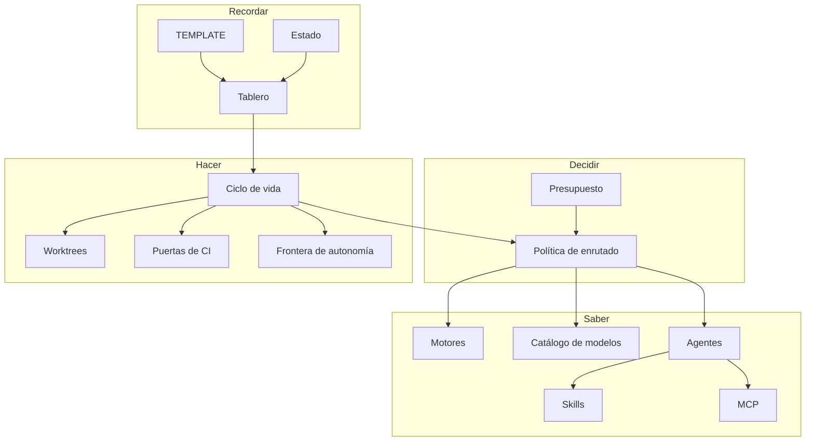

# MOC · Cortex

*Mapa de contenidos.* Si abres `CORTEX/` como bóveda de Obsidian, esta es la
nota raíz: todo cuelga de aquí y el grafo se dibuja solo.

## El cerebro, por capas

## Decidir

- [[Politica-de-enrutado]] — **la página central.** Qué motor y qué modelo para cada clase de tarea
- [[Presupuesto]] — cómo se decide cuando la cuota aprieta

## Saber

- [[Motores]] — Claude Code, Codex CLI, OpenCode, Orca: versiones reales
- [[Catalogo-de-modelos]] — precios, y por qué algunos no se usan
- [[Agentes]] — los cinco subagentes y su modelo
- [[Skills]] — conocimiento que se carga solo cuando hace falta
- [[MCP]] — integraciones externas, conectadas y caídas
- [[Automatizaciones]] — lo que corre sin que nadie lo lance

## Hacer

- [[Ciclo-de-vida]] — de la bandeja al merge, con sus puertas
- [[Worktrees]] — un árbol por tarea, y sus trampas
- [[Puertas-de-CI]] — los cinco checks obligatorios y su equivalente local
- [[Frontera-de-autonomia]] — dónde termina lo automático

## Recordar

- [[Estado]] — dónde estoy ahora
- [[Tablero]] — el trabajo real, ya clasificado
- [[TEMPLATE]] — de aquí sale cada ficha
- [[Glosario]] — qué significa cada término de este repo

## Las fuentes de verdad del producto

CORTEX dice **cómo se trabaja**. Lo que se construye está en otro sitio, y
esas fuentes mandan (`AGENTS.md`):

1. `DOCUMENTOS/PLATAFORMA/PLANIFICACION/NN-*.md` — requisitos
2. `DOCUMENTOS/PLATAFORMA/IMPLEMENTACION/NN-*.md` — checklist y evidencia
3. `DOCUMENTOS/PLATAFORMA/ROADMAP.md` — orden de trabajo
4. `DOCUMENTOS/PLATAFORMA/IMPLEMENTACION/00-BACKLOG-GLOBAL.md` — inventario

`tash/` es material histórico y nunca prevalece sobre ellas.
