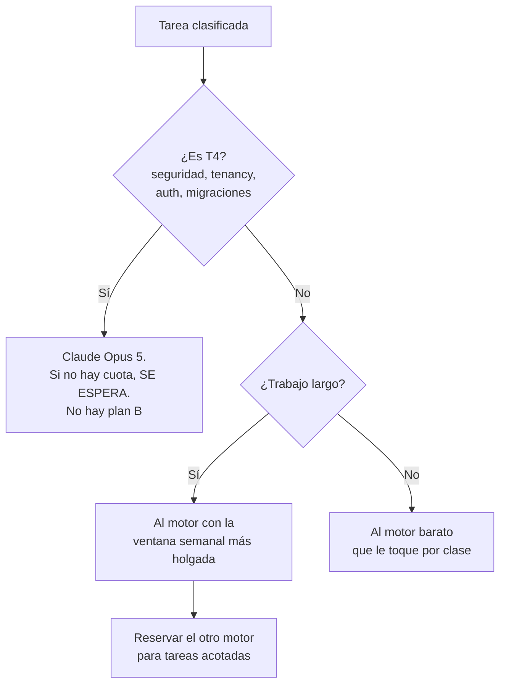

# Presupuesto — cómo se decide con la cuota en la mano

El coste por token casi nunca es la restricción. La restricción es la
**ventana semanal** de cada suscripción: cuando se agota, el motor deja de
estar disponible aunque la tarea sea urgente.

## La regla



**T4 no negocia con el presupuesto.** Una fuga multi-tenant escrita por un
modelo barato porque Opus estaba agotado cuesta más que esperar al lunes.

## Mirar antes de lanzar

```powershell
# [LAPTOP PowerShell] -> lo ejecuto yo
pwsh -File "CORTEX\herramientas\estado.ps1"
```

Muestra, en este orden: estado de los PR abiertos, qué puertas de CI están
en rojo, worktrees vivos y trabajo sin commitear.

El consumo de cada motor **no** sale de ahí: se lee en cada CLI. En Claude
Code, con `/status`; en Codex y OpenCode, en su propia interfaz.

## Lo que se aprendió en el proyecto hermano

En `francos-dev-workspace`, con una lectura de `claude semanal 3%` frente a
`codex semanal 58%`, el trabajo largo se mandó entero a Claude y Codex quedó
de revisor. La decisión se tomó **mirando el número**, no por preferencia.

Ese es el único criterio que ha sobrevivido: *mirar antes de lanzar*.

## Señales de que el enrutado está mal calibrado

| Síntoma | Qué significa | Qué cambiar |
| --- | --- | --- |
| Opus agotado a mitad de semana | Está haciendo trabajo de T0 y T1 | Bajar barridos a Haiku y mecánica a OpenCode |
| Diffs de OpenCode que nunca compilan | Las tareas T1 no son autocontenidas | Acotar más, o subirlas a T2 |
| Codex repite lo que ya sabías | Se le está dando contexto de más | Darle el diff a secas, sin contarle la intención |
| Se revisa poco lo delegado | La velocidad es aparente | Volver a meter la revisión dentro del ciclo |

Volver a [[Politica-de-enrutado]] · [[Catalogo-de-modelos]]
