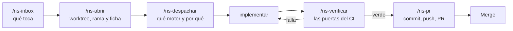

# Ciclo de vida de un pendiente

Una ejecución trata **un solo** pendiente `NN-P-NN`. Si se mezclan dos, se
separan en ramas y PR independientes.

`/ns-estado` dice dónde estás en cualquier momento. No cambia nada.

## Las etapas

| # | Etapa | Comando | Quién | ¿Escribe? |
| --- | --- | --- | --- | --- |
| 0 | Bandeja | `/ns-inbox` | principal | No |
| 1 | Abrir | `/ns-abrir NN-P-NN` | principal | Sí — worktree, rama y ficha |
| 2 | **Despachar** | `/ns-despachar NN-P-NN` | principal | Solo la ficha |
| 3 | Implementar | según el despacho | el motor asignado | Sí |
| 4 | Verificar | `/ns-verificar` | `ns-revisor-ci` | **No** |
| 5 | Entregar | `/ns-pr` | principal | Sí, con confirmación |

La etapa 2 es la que no tiene el proyecto hermano. Ahí se decide si el
trabajo se queda en Claude Opus, baja a Sonnet o Haiku, o sale a Codex o
OpenCode. El criterio completo está en [[Politica-de-enrutado]].

## Puertas de paso

No se avanza sin cumplir la puerta de la etapa:

| Para pasar a | Hace falta |
| --- | --- |
| `/ns-abrir` | El pendiente existe en `DOCUMENTOS/PLATAFORMA/IMPLEMENTACION/` con sus criterios |
| `/ns-despachar` | Ficha en `40-TAREAS/` sin decisiones de diseño abiertas |
| implementar | La ficha dice motor, modelo y motivo |
| `/ns-verificar` | Implementación terminada y worktree sin cambios ajenos |
| `/ns-pr` | Las puertas del CI en verde, o las omitidas declaradas con su motivo |
| merge | CI verde de verdad y autorización humana |

## La regla de los tres bloques

Toda ficha separa, siempre, tres cosas:

- **Hechos auditados** — con evidencia `archivo:línea`, commit o salida de
  comando.
- **Supuestos** — con quién los confirma.
- **Decisiones pendientes** — con quién decide y si bloquea.

Un supuesto escrito como hecho es la forma más cara de equivocarse en este
repo: ya pasó con «el `npm audit` salió en verde» cuando el código de salida
venía contaminado por la tubería, y con «hay dos *heads* de Alembic» por un
error de expresión regular.

## Definición de terminado

Un pendiente no está terminado porque compile. Debe:

1. Cumplir los criterios marcados como alcance.
2. Traer pruebas del comportamiento nuevo **en el mismo PR**.
3. Pasar las puertas del CI.
4. Declarar las pruebas ejecutadas **y las omitidas**.
5. Dejar el checklist de `DOCUMENTOS/PLATAFORMA/IMPLEMENTACION/` tachado con
   evidencia verificable. **Nunca borrado**: tachado.
6. No introducir dependencias silenciosas entre backend y frontend.

*Listo* solo después del merge y de la verificación final.

Ver también: [[Worktrees]] · [[Puertas-de-CI]] · [[Frontera-de-autonomia]]
