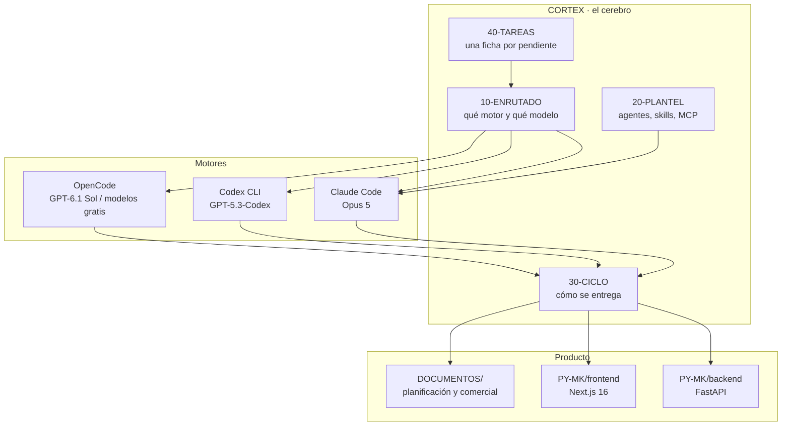

# CORTEX — el cerebro de NinjaSec

Esto no es código del producto. Es el **plano de control**: dónde está
escrito qué se hace, quién lo hace, con qué motor de IA y hasta dónde llega
solo antes de pedir permiso.

Está pensado para leerse de dos maneras y que las dos digan lo mismo:

- **Como carpeta de trabajo**, desde Claude Code abierto en la raíz del repo.
- **Como bóveda de Obsidian**, abriendo `CORTEX/` como *vault*. Los enlaces
  entre dobles corchetes funcionan, el grafo se dibuja solo y se navega
  con el ratón.



## Por dónde se empieza

| Si quieres… | Abre |
| --- | --- |
| Saber dónde estoy ahora | [`00-MAPA/Estado.md`](00-MAPA/Estado.md) |
| Ver el mapa entero | [`00-MAPA/MOC-Cortex.md`](00-MAPA/MOC-Cortex.md) |
| **Decidir qué motor usar para una tarea** | [`10-ENRUTADO/Politica-de-enrutado.md`](10-ENRUTADO/Politica-de-enrutado.md) |
| Saber qué agentes existen | [`20-PLANTEL/Agentes.md`](20-PLANTEL/Agentes.md) |
| Entregar una tarea sin romper nada | [`30-CICLO/Ciclo-de-vida.md`](30-CICLO/Ciclo-de-vida.md) |
| Abrir un pendiente nuevo | [`40-TAREAS/TEMPLATE.md`](40-TAREAS/TEMPLATE.md) |

## El ciclo, en una línea

```
/ns-inbox → /ns-abrir NN-P-NN → /ns-despachar → implementar → /ns-verificar → /ns-pr
```

`/ns-despachar` es la pieza nueva: lee la ficha, clasifica la tarea y dice
**qué motor y qué modelo** le toca, con el motivo. No es un capricho de
coste: hay trabajo que **nunca** sale de Claude con las reglas del repo
cargadas, y hay trabajo mecánico que gastar en Opus es tirar cuota.

## Las tres reglas que no se negocian

1. **Nada que toque `organization_id`, autenticación o Alembic se delega.**
   Ni a Codex, ni a OpenCode, ni a un subagente barato. Radio de daño máximo.
2. **Ningún motor hace merge.** El PR lo fusiona una persona, o Claude con
   autorización explícita y el CI en verde de verdad.
3. **Lo que no se ejecutó no se declara verde.** Una puerta de CI no corrida
   se reporta como no corrida, con el motivo.

Detalle en [`30-CICLO/Frontera-de-autonomia.md`](30-CICLO/Frontera-de-autonomia.md).

## Qué NO es esto

No es un tablero de proyecto ni sustituye a `DOCUMENTOS/PLATAFORMA/`. Las
fuentes de verdad del producto siguen siendo las de `AGENTS.md`:
planificación, implementación y `ROADMAP.md`. CORTEX dice **cómo se trabaja**;
`DOCUMENTOS/` dice **qué se construye**.
