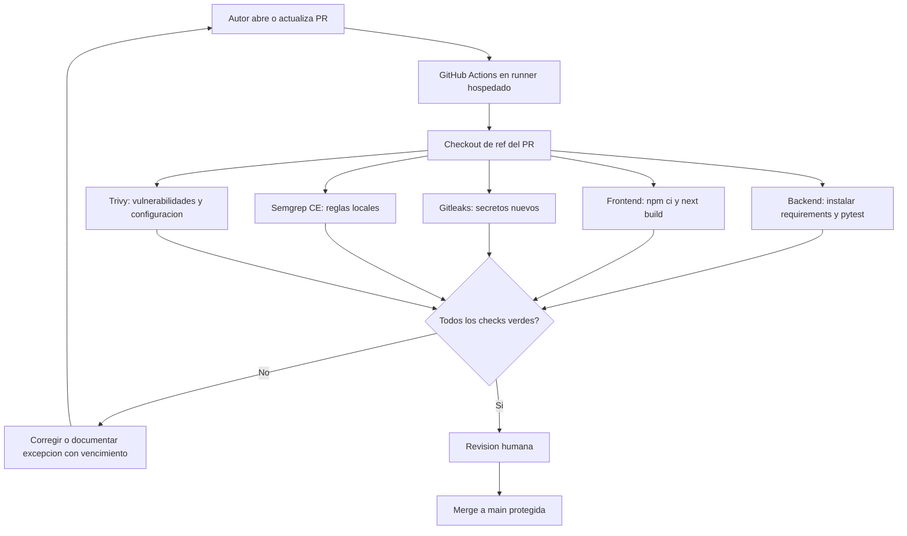
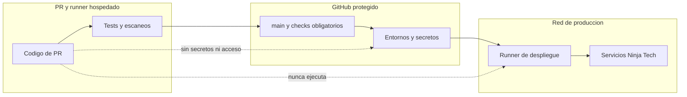

# CI y controles de pull request

> Cubre `33-P-01` a `33-P-05`. Este documento describe lo que se creara;
> no activa workflows ni cambia la configuracion de GitHub.

## Resultado esperado

Cada pull request recibe checks reproducibles sin secretos ni acceso a la red
de produccion. Un fallo de pruebas, build o secreto nuevo bloquea el merge.
Los hallazgos de SAST y vulnerabilidades se introducen de forma gradual para no
confundir deuda previa con una regresion nueva.

## Flujo de pull request



## Archivos que se deben crear

Todos quedan en la raiz del repositorio Git, no dentro de `PY-MK/`.

| Archivo | Responsabilidad | Pendiente |
|---|---|---|
| `.github/workflows/ci.yml` | Amplia CI existente: tests backend, migraciones, auditoria npm y build frontend | `33-P-01`, `33-P-02` |
| `.github/workflows/security.yml` | Gitleaks, Semgrep CE y Trivy | `33-P-03`, `33-P-04` |
| `.github/dependabot.yml` | Actualizaciones revisables de Python, npm y Actions | `33-P-05` |
| `.semgrep/` | Reglas propias de seguridad y calidad | `33-P-04` |
| `.trivyignore` | Excepciones justificadas, fechadas y revisables | `33-P-04` |
| `.gitleaks.toml` | Solo si aparece un falso positivo conocido; nunca secretos reales | `33-P-03` |

## Implementacion de CI base

1. Auditar y ampliar el `.github/workflows/ci.yml` existente con triggers de
   `pull_request`, `push` a `main` y ejecucion manual. No usar
   `pull_request_target`.
2. Conservar la prueba Alembic con PostgreSQL efimero y la auditoria npm
   critica; son controles que ya protegen el repositorio.
3. Definir permisos minimos a nivel de workflow. No agregar
   permisos de escritura ni `id-token` hasta que exista una necesidad real.
4. Agregar concurrencia por workflow y ref para cancelar ejecuciones viejas
   de una misma PR, sin cancelar `main`.
5. Fijar cada action externa a un SHA concreto revisado; las etiquetas como
   `@v4` no son el estado final aceptable.
6. En el job de backend usar Python 3.12, instalar
   `PY-MK/backend/requirements.txt` y ejecutar desde `PY-MK/backend`:

   ```bash
   PYTHONPATH=. pytest -q
   ```

7. En el job de frontend usar Node 20, ejecutar desde `PY-MK/frontend`:

   ```bash
   npm ci
   NEXT_PUBLIC_API_URL=/api/v1 npm run build
   ```

8. No publicar artefactos, imagenes ni reportes que puedan contener datos de
   prueba sensibles durante esta fase.
9. Abrir una PR de prueba que demuestre que un test roto y un build roto hacen
   fallar checks distintos. Registrar los enlaces de ejecucion en `33-P-01` y
   `33-P-02`.

## Controles de seguridad

| Control | Modo inicial | Gate final | Regla operativa |
|---|---|---|---|
| Gitleaks | Bloqueante desde la primera PR | Bloqueante | Ninguna exclusion tapa una credencial real |
| Semgrep CE | Reporte con reglas de alta confianza | Bloqueante solo para reglas acordadas | Reglas locales versionadas y revisadas |
| Trivy | Reporte de filesystem y configuracion | Bloquea severidad alta o critica acordada | Excepciones tienen motivo, responsable y fecha de revision |
| Dependabot | Crea PRs | Sin auto-merge inicial | Una persona revisa changelog, CI y compatibilidad |

Semgrep CE usa configuracion local de alta confianza y `--error`, por lo que
sus hallazgos bloquean. Trivy escanea inicialmente `vuln,misconfig`; Gitleaks
es el unico control de secretos para evitar resultados duplicados.

## Limites de confianza



## Acciones humanas necesarias

1. Crear proteccion de `main` en GitHub y exigir los checks de CI y seguridad.
2. Decidir las severidades de Trivy y las reglas Semgrep que bloquean despues
   de medir resultados en PRs reales.
3. Revisar cada exclusion antes de incorporarla al repositorio.
4. Confirmar que el plan de la cuenta GitHub cubre el uso esperado de Actions.

## Definition of done

- `ci.yml` pasa en una PR real y en `main`.
- Un fallo intencional de test y otro de build prueban que los gates funcionan.
- Gitleaks bloquea una muestra inocua generada solo para la prueba y no deja
  secretos en la historia Git.
- Los hallazgos Semgrep y Trivy tienen una linea base explicita o una fecha de
  correccion; no se silencian sin trazabilidad.
