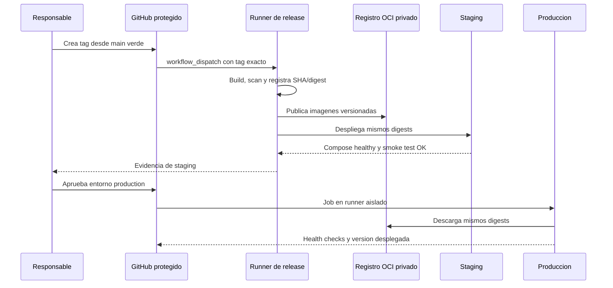
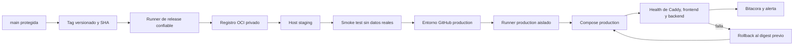

# CD, staging y recuperacion

> Cubre `33-P-06` a `33-P-09`. No se activa CD hasta que CI y seguridad esten
> verdes y exista un destino de staging separado de produccion.

## Problema que resuelve

`PY-MK/infra/docker-compose.prod.yml` hoy construye backend y frontend desde
el codigo presente en el host. Esto sirve para un arranque manual, pero no
garantiza que staging y produccion ejecuten exactamente el mismo artefacto. La
implementacion debe promocionar una version identificable y registrar sus
digests, sin usar `git pull` como mecanismo de despliegue.

## Flujo de promocion

## Arquitectura de entornos

## Cambios previstos al repositorio

| Archivo o recurso | Cambio requerido | Pendiente |
|---|---|---|
| `PY-MK/infra/docker-compose.prod.yml` | Separar build local de ejecucion por `image` versionada | `33-P-06` |
| `PY-MK/infra/docker-compose.release.yml` | Overlay que recibe tags o digests inmutables | `33-P-06` |
| `.github/workflows/release.yml` | Construye, escanea y publica solo desde tag confiable | `33-P-06` |
| `.github/workflows/deploy-staging.yml` | Promueve una version indicada a staging | `33-P-06` |
| `.github/workflows/deploy-production.yml` | Despliega solo con entorno `production` aprobado | `33-P-07` |
| Host de staging | Runner exclusivo, sin datos de clientes reales | `33-P-06` |
| Host de produccion | Runner exclusivo con label de produccion | `33-P-07` |
| Registro OCI interno | Almacena imagenes de backend y frontend por digest | `33-P-06` |
| Runbook de backup/restauracion | Automatizacion, retencion y prueba de restore | `33-P-08` |

No se presupone GitHub Container Registry como costo cero para paquetes
privados. El registro OCI se decide antes de implementarlo: puede ser un
servicio autoalojado en infraestructura existente o un servicio externo
aprobado explicitamente.

## Instrucciones de implementacion

### 1. Preparar artefactos inmutables

1. Definir el formato de version, por ejemplo `vMAJOR.MINOR.PATCH`.
2. Permitir releases solo desde un tag creado sobre `main` con CI verde.
3. En el workflow de release, guardar en un manifiesto la version, SHA de
   commit, digest de backend, digest de frontend, fecha y resultado de scans.
4. Refactorizar Compose para que staging y produccion reciban las imagenes por
   digest. El Compose actual conserva `build` para desarrollo local; el overlay
   de release no debe construir desde el checkout del host.
5. Aplicar Trivy a las imagenes antes de publicarlas. Un hallazgo bloqueante no
   genera una version promocionable.

### 2. Desplegar staging

1. Crear un runner con labels `self-hosted`, `linux` y `ninjasec-staging`.
2. Aceptar solo jobs originados desde tags confiables o `workflow_dispatch`.
3. Descargar los digests declarados, ejecutar Compose y esperar que los
   contenedores esten saludables.
4. Comprobar los tres niveles existentes:
   - Caddy: `GET /health` responde 200.
   - Frontend: healthcheck local de `/login` responde correctamente.
   - Backend: healthcheck interno del contenedor responde correctamente.
5. Registrar salida de `docker compose ps`, digests y URL de ejecucion. No
   ejecutar login automatizado con cuentas seed ni usar datos de clientes.

### 3. Proteger produccion

1. Crear el entorno GitHub `production` con revisores humanos obligatorios.
2. Crear un runner distinto con labels `self-hosted`, `linux` y
   `ninjasec-production`; no reutilizar el runner de CI ni el de staging.
3. Limitar el workflow a tags permitidos y al entorno `production`.
4. No dar al `GITHUB_TOKEN` permisos de escritura si el job solo despliega.
5. Bloquear cualquier evento de PR, fork o comentario que pueda llegar al
   runner de produccion.
6. Registrar version, SHA, digests, responsable de aprobacion y resultado de
   cada health check.

## Migraciones y rollback

El backend ejecuta Alembic al iniciar. Por ello cada migracion de una release
debe ser compatible con la version anterior de la aplicacion. La estrategia es
**expandir -> migrar datos -> contraer** en releases separadas; no se revierte
automaticamente el esquema al hacer rollback de imagenes.

| Situacion | Accion |
|---|---|
| Falla antes de migrar | Detener deploy y conservar version previa |
| Falla tras imagenes compatibles | Volver a los digests previos |
| Requiere restaurar datos | Pausar, aprobar restauracion y usar backup probado |
| Migracion destructiva propuesta | Separarla en fases y exigir plan de recuperacion aprobado |

## Backup y restauracion

El volumen `./backups:/backups` existente no realiza backups por si solo. La
implementacion de `33-P-08` debe crear una tarea del host o servicio dedicado
que cifre, retenga y verifique backups. La primera prueba de restauracion se
hace solo sobre una base desechable y con autorizacion expresa; nunca sobre la
base de produccion ni mediante operaciones destructivas no aprobadas.

La evidencia minima es: fecha, version restaurada, destino desechable, resultado
de integridad y responsable. No guardar claves, dumps ni datos de clientes en
logs de Actions o artefactos publicos.

## Definition of done

- Staging y produccion consumen el mismo digest de cada imagen.
- Un deploy fallido vuelve a una version anterior compatible sin adivinar SHA.
- El entorno `production` requiere aprobacion humana.
- Un backup automatico y una restauracion en entorno desechable estan probados.
- Ningun runner de produccion ejecuta codigo de PRs, forks o agentes.
