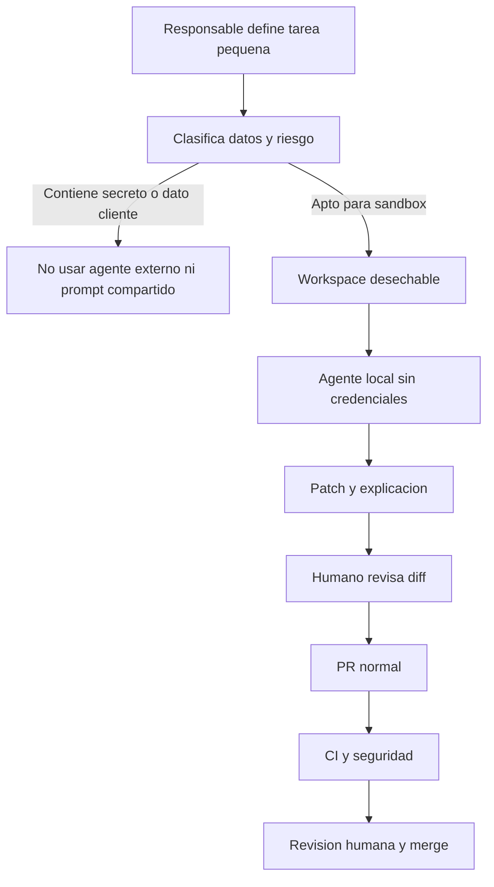
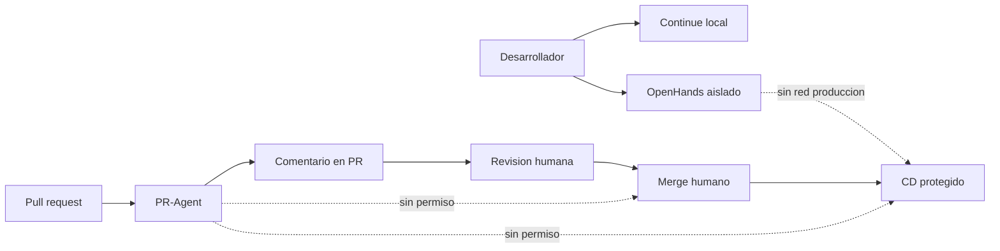

# Agentes abiertos y gobierno de IA

> Cubre `33-P-10` y `33-P-11`. El software de los agentes puede tener licencia
> abierta, pero un modelo local requiere capacidad de hardware y operacion.

## Objetivo

Usar asistentes para acelerar revision, exploracion y cambios pequenos sin
convertirlos en una identidad con privilegios de administracion. Los agentes no
son controles de seguridad ni reemplazan al responsable tecnico.

## Roles seleccionados

| Herramienta | Uso permitido | Inicio | Limite estricto |
|---|---|---|---|
| PR-Agent | Resumen y comentarios de PR | Piloto de dos semanas | No hace merge ni ejecuta deploy |
| Continue | Asistencia local en IDE | Manual por desarrollador | No recibe secretos ni datos de clientes |
| OpenHands | Tarea manual en sandbox desechable | Solo despues de validar el sandbox | No monta Docker del host ni llega a produccion |

## Flujo seguro de un agente de tareas

## Arquitectura de permisos

## Precondiciones para inferencia local

1. Identificar CPU, RAM, GPU, VRAM y espacio disponible sin instalar modelos
   todavia.
2. Seleccionar un modelo compatible con el hardware y probarlo con codigo no
   sensible ni configuraciones de clientes.
3. Definir limite de contexto, retencion de logs y ubicacion local de modelos.
4. Confirmar que la herramienta no telemetra prompts o codigo sin autorizacion.
5. Documentar consumo y calidad antes de ampliar su uso.

Si no existe hardware suficiente, el piloto se limita a instalar la herramienta
sin modelo o se posterga. No se redirige codigo de Ninja Tech a una API comercial
por defecto.

## PR-Agent: configuracion objetivo

1. Autoalojar el servicio o job en un host separado de CI y produccion.
2. Preferir una GitHub App en lugar de un PAT. Alcance minimo:
   - Metadata: lectura.
   - Contents: lectura.
   - Pull requests: lectura y comentarios.
3. Instalarla solo en `ninjasec-platform` durante el piloto.
4. Guardar webhook secret y credenciales de modelo fuera del repositorio.
5. Configurar salida como comentario no bloqueante; no cambiar labels, no cerrar
   issues y no aprobar ni hacer merge.
6. Desactivar procesamiento automatico de forks hasta revisar el modelo de
   amenaza de prompt injection.
7. Definir interruptor de apagado: desinstalar la App y detener el servicio.

## OpenHands: sandbox obligatorio

| Recurso | Politica |
|---|---|
| Repositorio | Copia temporal, no directorio de trabajo principal |
| Credenciales | Ninguna; no montar `.env`, SSH, GitHub CLI ni gestores de claves |
| Docker | Sin socket Docker del host |
| Red | Deshabilitada por defecto; excepcion temporal y aprobada para una fuente concreta |
| Escritura | Solo dentro del workspace temporal |
| Salida | Diff, pruebas ejecutadas y limitaciones; nunca cambios directos a `main` |

## Evaluacion del piloto

Durante dos semanas registrar por cada comentario o tarea: utilidad,
hallazgos correctos, falsos positivos, tiempo ahorrado, costo de recursos y
riesgo de privacidad. Al cierre se toma una sola decision por herramienta:
adoptar, ajustar o retirar.

El piloto se aprueba solo si la calidad es visible y no aumentan los permisos.
Un comentario incorrecto no debe bloquear una PR; una alerta de secreto o una
prueba fallida si debe hacerlo.

## Definition of done

- PR-Agent tiene permisos minimos y solo comenta.
- Continue y OpenHands no acceden a secretos ni datos reales de clientes.
- OpenHands opera en sandbox sin socket Docker ni red de produccion.
- Existe bitacora de dos semanas y decision fechada de adopcion o retiro.
