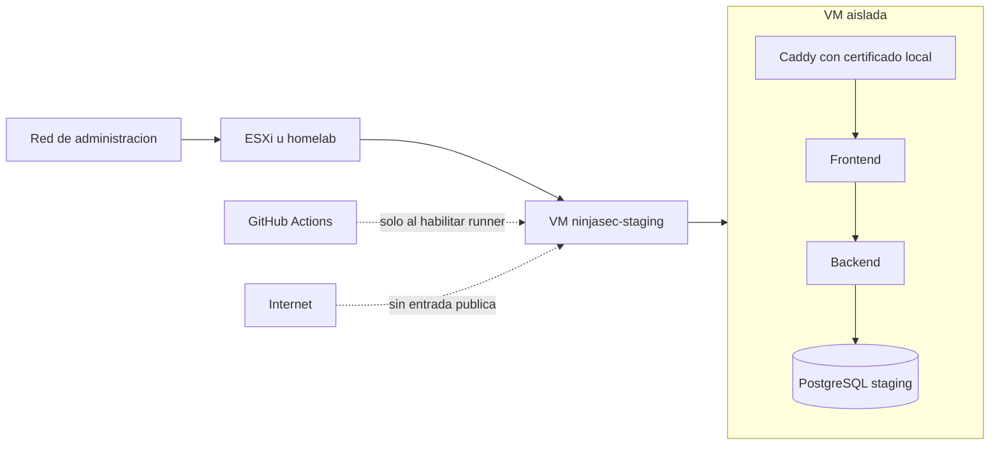
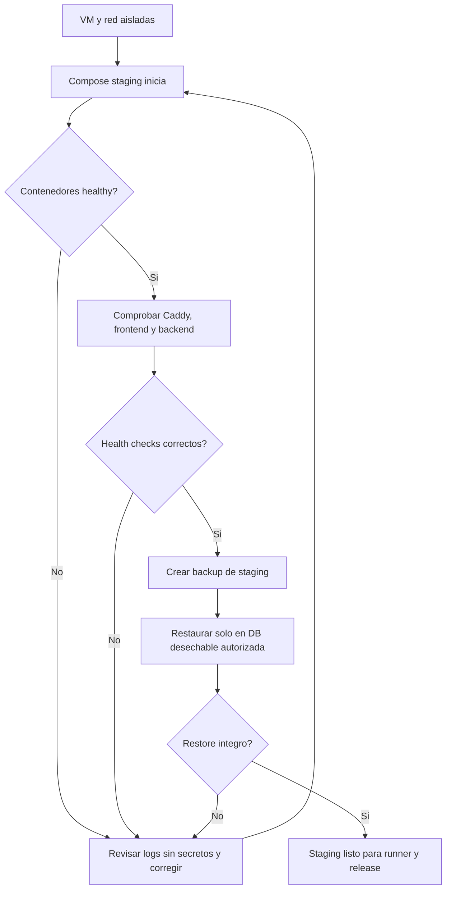

# Staging gratuito en ESXi

> Cubre la preparacion de `33-P-06`, `33-P-08` y `33-P-09`. No crea una VM,
> no abre puertos ni despliega NinjaSec.

## Decision recomendada

Usar una VM `ninjasec-staging` distinta de produccion sobre el ESXi u homelab
existente. No hay costo de proveedor cloud, aunque sigue habiendo costo de
hardware, electricidad, red y administracion. Esta opcion permite probar el
mismo Docker Compose que se usara en produccion sin exponer la aplicacion a
Internet ni mezclar datos de clientes.

## Alcance de staging

Staging valida versiones, migraciones compatibles, health checks y rollback de
aplicacion. No es una demo publica, no procesa datos de clientes, no usa
credenciales reales de integraciones y no sustituye las pruebas de produccion
protegida.

## Arquitectura objetivo

## Capacidad minima

| Recurso | Minimo | Recomendado | Motivo |
|---|---:|---:|---|
| CPU | 2 vCPU | 4 vCPU | Build de frontend, backend y base local |
| RAM | 4 GB | 6 GB | Docker, Next.js y PostgreSQL comparten memoria |
| Disco | 40 GB | 60 GB | Imagenes, volumen de DB, logs y backup corto |
| Red | Solo administracion | VLAN o port group propio | Separacion de desarrollo y produccion |
| Sistema | Ubuntu Server LTS | Ubuntu Server LTS actualizado | Docker y mantenimiento de seguridad |

Antes de crear la VM se debe confirmar espacio libre en el datastore y que la
reserva de recursos no afecte a las VMs existentes. Staging no usa GPU ni
modelos de IA.

## Aislamiento obligatorio

| Area | Regla de staging |
|---|---|
| Host | VM propia; no compartir host Docker con produccion |
| Red | Port group o VLAN de staging. Si se comparte una VLAN temporalmente, reglas de firewall mas restrictivas |
| Base de datos | Volumen, usuario, password y backup propios; nunca replica de produccion |
| Datos | Solo sinteticos, anonimizados o semillas no sensibles aprobadas |
| Secretos | Valores exclusivos de staging fuera de Git; nunca copiar `.env` de produccion |
| DNS y TLS | Nombre interno y certificado local; no requiere dominio publico ni DuckDNS |
| Acceso | SSH solo desde red de administracion con clave; sin acceso SSH desde Internet |
| Integraciones | Deshabilitadas o apuntando a mocks; prohibido conectar pfSense, Wazuh o clientes reales |

## Provisioning de la VM

El detalle de instalaciones y la secuencia de arranque se mantiene en
`07-PROVISIONAMIENTO-UBUNTU-STAGING.md` para no duplicar un runbook operativo.

### 1. Crear la VM en ESXi

1. Crear una VM llamada `ninjasec-staging` con capacidad indicada arriba.
2. Seleccionar un port group de staging. Si aun no existe, crear primero el
   segmento y sus reglas; no reutilizar produccion por comodidad.
3. Instalar Ubuntu Server LTS con actualizaciones de seguridad habilitadas.
4. Crear un usuario administrativo nominal, sin usar `root` para operaciones
   diarias. Configurar acceso SSH por clave desde la red de administracion.
5. Tomar un snapshot llamado `staging-base-limpio` antes de instalar servicios.
   El snapshot facilita recuperacion de la VM, pero no reemplaza backups de DB.

### 2. Endurecer el host

1. Instalar Docker Engine, Docker Compose plugin, Git y utilidades de salud.
2. Configurar firewall con politica de entrada denegada por defecto:
   - SSH solo desde la red de administracion.
   - HTTPS interno solo desde las redes que deban probar staging.
   - Sin reglas WAN, NAT ni puertos publicos.
3. Activar actualizaciones de seguridad del sistema y rotacion de logs.
4. Crear una cuenta de servicio de staging solo cuando se habilite CD. Esa
   cuenta no se reutiliza para produccion y no recibe acceso administrativo
   general.

### 3. Preparar el stack

1. Clonar el repositorio en una ruta de servicio, con permisos de la cuenta de
   staging. No colocar secretos dentro del checkout.
2. Crear configuracion exclusiva fuera del repositorio usando
   `PY-MK/infra/.env.example` como lista de variables. No leer, copiar ni
   reutilizar un `.env` de otro entorno.
3. Definir `SEED_ON_STARTUP=false`. Crear solo datos sinteticos necesarios
   mediante un procedimiento aprobado; no usar cuentas seed conocidas en un
   entorno accesible por terceros.
4. Crear un overlay de Compose de staging como trabajo de `33-P-06`. Debe
   diferenciar nombre de proyecto, volumenes, rutas de backup, hostname y
   configuracion de Caddy respecto a produccion.
5. Para TLS interno, habilitar un Caddyfile especifico de staging con
   certificado local. No publicar el nombre interno en DNS externo.
6. Arrancar inicialmente de forma manual y documentada, solo despues de que
   una version concreta pase CI. El despliegue automatizado llega despues.

## Validacion antes de CD

La comprobacion de salud cubre los recursos que ya existen en Compose:

| Nivel | Evidencia requerida |
|---|---|
| Reverse proxy | `/health` de Caddy responde 200 |
| Frontend | Healthcheck local de `/login` es exitoso |
| Backend | Healthcheck interno del contenedor es exitoso |
| Base de datos | Compose reporta Postgres saludable |
| Aislamiento | No hay conexiones a integraciones o bases de produccion |

## Backups y restauracion de staging

El montaje `./backups:/backups` no ejecuta backups automaticamente. Antes de
usar staging como gate de release se debe implementar una tarea programada que:

1. Genere backup consistente de la DB de staging.
2. Lo guarde en una ruta con permisos restringidos y retencion corta definida.
3. Registre solo estado, fecha y checksum; nunca credenciales ni contenido.
4. Restaure periodicamente en una DB temporal autorizada.
5. Elimine la DB temporal y el backup segun la retencion aprobada.

No se ejecutan `DROP`, `DELETE` o restauraciones sobre ambientes con datos sin
autorizacion expresa y respaldo comprobado.

## Runner de staging, solo despues de CI

El runner se instala unicamente cuando `33-P-01` a `33-P-05` esten verdes. Se
registra con labels `self-hosted`, `linux` y `ninjasec-staging`, y sus jobs:

- aceptan tags o `workflow_dispatch` de ramas protegidas;
- no reciben eventos de pull requests, forks o comentarios;
- usan configuracion de staging, no secretos de produccion;
- registran SHA, digests, health checks y resultado de rollback.

Hasta ese momento GitHub-hosted runners cubren CI; la VM no necesita instalar
un runner para validar el stack manualmente.

## Alternativa: Oracle Cloud Always Free

Solo usar esta alternativa si no hay capacidad en ESXi. [Oracle documenta los
recursos Always Free](https://docs.oracle.com/en-us/iaas/Content/FreeTier/freetier_topic-Always_Free_Resources.htm):
hasta 2 OCPU y 12 GB de memoria para Ampere A1, y 200 GB de almacenamiento de
bloques. Es suficiente para una VM de staging, pero la disponibilidad de
capacidad y la elegibilidad de cuenta se confirman directamente en la consola
antes de comprometer el plan.

| Criterio | ESXi propio | Oracle Always Free |
|---|---|---|
| Costo de proveedor | Cero adicional si ya existe hardware | Cero dentro de limites Always Free |
| Exposicion publica | No necesaria | Requiere reglas cloud cuidadosamente cerradas |
| Arquitectura | Normalmente x86_64 | Ampere A1 usa Arm; requiere prueba de build Docker |
| Control de red | Total dentro del lab | Depende de VCN, security lists y cuenta |
| Riesgo principal | Capacidad y disponibilidad del homelab | Capacidad regional, cuenta y configuracion cloud |

Si se elige Oracle, primero hacer una prueba desechable de `docker compose`
con las imagenes reales y los health checks; no migrar datos ni habilitar CD
hasta validar compatibilidad Arm y aislamiento de red.

## Definition of done

- VM staging aislada, endurecida y sin exposicion publica.
- Datos, DB, secretos, hostname y backups propios de staging.
- Caddy, frontend, backend y Postgres saludables con evidencia.
- Backup y restauracion en DB desechable probados.
- Ninguna integracion real de cliente configurada.
- Runner de staging pendiente hasta que CI y seguridad esten verdes.
