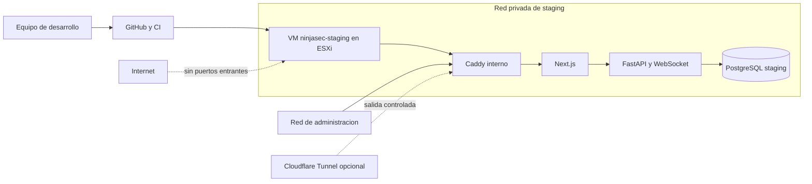
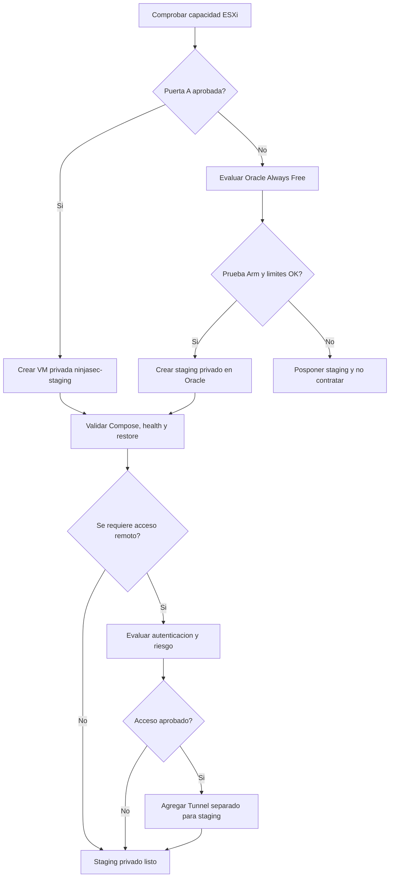

# Decision de hosting para staging

> Decision de arquitectura para `33-P-06`. No habilita hosting, cuentas cloud,
> dominios, tuneles ni despliegues.

## Decision recomendada

**Elegir ESXi u homelab existente como host de staging, en una VM privada y
aislada.** Cloudflare Tunnel es opcional y se evalua despues como acceso remoto
controlado, no como host de NinjaSec. Oracle Always Free es el plan de
contingencia si el ESXi no tiene capacidad disponible.

La recomendacion conserva el stack actual: Docker Compose, FastAPI con Uvicorn,
PostgreSQL persistente, Caddy y WebSocket. Evita rediseñar el producto solo para
adaptarlo a los limites de una plataforma serverless gratuita.

## Comparacion

| Opcion | Encaje con NinjaSec | Costo directo | Decision |
|---|---|---|---|
| ESXi + VM privada | Completo: Docker, Postgres, WebSocket y red propia | Cero adicional si el homelab existe | **Elegida** |
| ESXi + Cloudflare Tunnel | Igual que ESXi; agrega acceso remoto sin puertos entrantes | Tunnel sin plan pago; requiere cuenta y control de acceso | Opcional despues de validar staging privado |
| Oracle Always Free | Puede ejecutar stack completo; requiere validar Arm | Dentro de limites Always Free | Contingencia si no hay capacidad ESXi |
| Vercel | Bueno para preview de frontend; no para stack completo actual | Puede tener nivel gratuito | No usar como staging integral |
| Cloudflare Workers | Requiere adaptar backend al runtime serverless | Tiene nivel gratuito con limites | No usar como staging integral |

## Por que no Vercel o Workers como staging completo

Vercel puede desplegar frontend y funciones FastAPI, incluso WebSockets bajo
Fluid Compute, pero las conexiones tienen limites de duracion y el estado debe
externalizarse. Se tendria que separar frontend y backend, rediseñar CORS y
reemplazar el proxy de mismo dominio que NinjaSec ya utiliza.

Cloudflare Workers admite FastAPI adaptado a ASGI y WebSockets, pero su modelo
serverless no ejecuta el Docker Compose ni Uvicorn persistente actuales. En su
nivel Free hay limites de CPU y memoria que no son una base prudente para el
backend completo y PostgreSQL del producto.

Ambos se pueden reevaluar solo para previews del frontend, como trabajo separado
del staging integral. No forman parte de `33-P-06`.

## Arquitectura elegida

## Puertas de decision

### Puerta A: usar ESXi

Se elige ESXi si se confirma:

1. Datastore con al menos 60 GB disponibles para la VM y sus snapshots.
2. Capacidad libre de 4 vCPU y 6 GB RAM recomendados, sin degradar VMs actuales.
3. Port group o VLAN de staging con acceso solo desde administracion.
4. Una persona responsable de actualizaciones de Ubuntu, Docker y backups.

Si una condicion falla, no se fuerza la VM. Se pasa a la Puerta B.

### Puerta B: Oracle Always Free

Se evalua Oracle solo si ESXi no cumple la Puerta A. Antes de usarlo:

1. Confirmar disponibilidad de instancia Always Free en la region elegida.
2. Crear una VM desechable Arm y probar build, Compose y health checks.
3. Definir VCN, firewall y acceso administrativo sin abrir servicios
   innecesarios.
4. Confirmar que el uso se mantiene dentro de los limites gratuitos vigentes.

Un fallo de compatibilidad Arm o disponibilidad devuelve la decision a ESXi o
pospone staging; no activa automaticamente un servicio de pago.

## Plan de ejecucion recomendado

## Cloudflare Tunnel: uso opcional y seguro

Cloudflare Tunnel no ejecuta NinjaSec; enruta trafico desde Cloudflare hacia un
servicio que ya vive en la VM. `cloudflared` abre conexiones salientes, por lo
que staging puede mantener bloqueado todo trafico entrante. Cloudflare documenta
que publicar por Tunnel no requiere un plan Cloudflare Access de pago, pero eso
no sustituye decidir quien puede llegar a staging.

Antes de habilitarlo se exige:

1. Confirmar una politica de autenticacion y usuarios autorizados.
2. Crear un tunel exclusivo de staging, nunca reutilizado por produccion.
3. Permitir solo la salida necesaria de `cloudflared`; no abrir WAN hacia la VM.
4. Guardar credenciales del tunel fuera de Git y fuera de logs de CI.
5. Verificar que la URL no expone paneles, Swagger, datos seed ni integraciones.
6. Tener un interruptor de apagado: detener `cloudflared`, revocar credenciales
   y borrar el hostname del tunel.

El Tunnel queda desactivado mientras staging sea accesible desde la red de
administracion. No es requisito para `33-P-06`.

## Criterios de cierre

- Decision documentada: ESXi elegido o contingencia Oracle justificada.
- Staging inicia privado, con datos y secretos propios.
- Vercel y Workers no se usan como atajo para despliegue integral.
- Cloudflare Tunnel solo se habilita tras aprobacion de acceso remoto.
- Ninguna cuenta, servicio o recurso de pago se activa por este plan.

## Referencias

- `05-STAGING-GRATUITO-ESXI.md`
- `02-CD-STAGING-Y-RECUPERACION.md`
- [Vercel Backends](https://vercel.com/docs/frameworks/backend)
- [Cloudflare Workers limits](https://developers.cloudflare.com/workers/platform/limits/)
- [Cloudflare Tunnel outbound-only](https://developers.cloudflare.com/cloudflare-one/networks/connectors/cloudflare-tunnel/)
