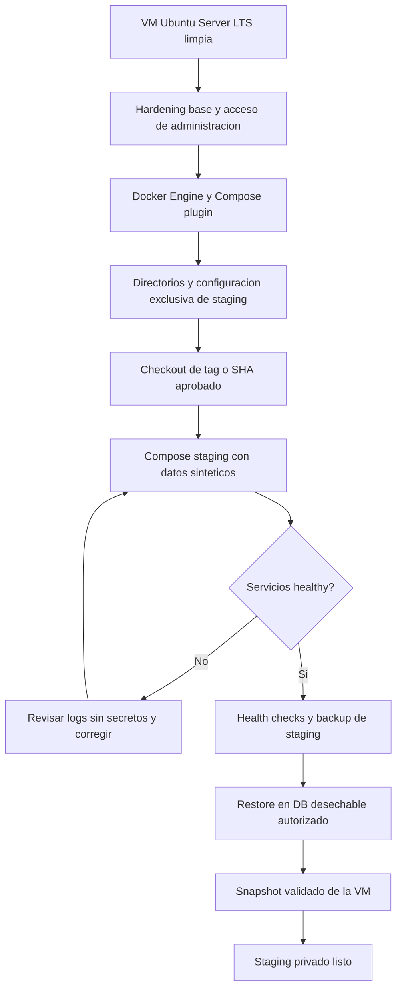

# Provisionamiento de Ubuntu Server para staging

> Runbook de planificacion para `33-P-06`, `33-P-08` y `33-P-09`.
> Se ejecuta solo despues de aprobar la Puerta A de
> `06-DECISION-HOSTING-STAGING.md`. No contiene secretos ni inicia despliegues
> publicos.

## Que se instala en el servidor

| Componente | Se instala en host | Se ejecuta en contenedor | Momento |
|---|---|---|---|
| Ubuntu Server LTS | Si | No | Provisionamiento inicial |
| Docker Engine y Compose plugin | Si | No | Provisionamiento inicial |
| Git, curl, certificados, UFW, actualizaciones y Fail2ban | Si | No | Provisionamiento inicial |
| Caddy | No | Si, por Compose | Al levantar staging |
| Frontend Next.js | No | Si, por Compose | Al levantar staging |
| Backend FastAPI y Uvicorn | No | Si, por Compose | Al levantar staging |
| PostgreSQL | No | Si, por Compose | Al levantar staging |
| Python y Node.js | No | Si, dentro de imagenes | Al construir o ejecutar imagenes |
| GitHub Actions runner | No inicialmente | No | Solo despues de `33-P-01` a `33-P-05` |
| cloudflared | No inicialmente | Opcional | Solo si se aprueba Tunnel |

**No instalar PostgreSQL, Caddy, Python o Node globalmente.** El stack actual
en `PY-MK/infra/docker-compose.prod.yml` ya los define como contenedores. Eso
mantiene staging parecido a produccion y evita versiones distintas en el host.

## Flujo de arranque de staging



## Requisitos previos humanos

1. Aprobar ESXi como host y asignar port group o VLAN de staging.
2. Reservar IP interna, hostname interno y red de administracion autorizada.
3. Definir responsable operativo de actualizaciones, backups y accesos.
4. Crear una clave SSH exclusiva para administracion de staging; no reutilizar
   claves de produccion.
5. Confirmar que staging solo usara datos sinteticos y no conectara
   integraciones reales de clientes.

## 1. Crear y actualizar la VM

1. Crear `ninjasec-staging` con 4 vCPU, 6 GB RAM y 60 GB de disco recomendado.
2. Instalar una imagen actual de Ubuntu Server LTS soportada por Docker.
3. Aplicar actualizaciones del sistema antes de instalar servicios.
4. Crear un usuario administrativo nominal; deshabilitar el uso operativo de
   `root` y configurar acceso SSH por clave.
5. Crear el snapshot `staging-base-limpio` antes de agregar Docker o la app.

El snapshot facilita recuperar la VM, pero no sustituye backup de PostgreSQL ni
una prueba de restauracion.

## 2. Paquetes base del host

Instalar solo utilidades de sistema necesarias para operar la VM:

```bash
sudo apt update
sudo apt install -y ca-certificates curl git ufw fail2ban unattended-upgrades jq
```

Despues, habilitar las actualizaciones de seguridad siguiendo la politica del
equipo. Este paso se valida en una VM nueva; no se ejecuta a ciegas sobre un
host que ya contenga servicios.

## 3. Instalar Docker Engine y Compose

Usar el [repositorio oficial de Docker para Ubuntu](https://docs.docker.com/engine/install/ubuntu/), no un script remoto sin revisar. La secuencia vigente es:

```bash
sudo apt update
sudo install -m 0755 -d /etc/apt/keyrings
sudo curl -fsSL https://download.docker.com/linux/ubuntu/gpg -o /etc/apt/keyrings/docker.asc
sudo chmod a+r /etc/apt/keyrings/docker.asc

sudo tee /etc/apt/sources.list.d/docker.sources > /dev/null <<EOF
Types: deb
URIs: https://download.docker.com/linux/ubuntu
Suites: $(. /etc/os-release && echo "${UBUNTU_CODENAME:-$VERSION_CODENAME}")
Components: stable
Architectures: $(dpkg --print-architecture)
Signed-By: /etc/apt/keyrings/docker.asc
EOF

sudo apt update
sudo apt install -y docker-ce docker-ce-cli containerd.io docker-buildx-plugin docker-compose-plugin
sudo docker run hello-world
sudo docker compose version
```

La cuenta que controla Docker tiene privilegios equivalentes a administrador
del host. No agregar usuarios, agentes o runners al grupo `docker` por
comodidad. El acceso se concede solo a la cuenta de servicio definida y
auditada al habilitar CD.

## 4. Red y firewall

Aplicar una politica de minimo privilegio. Los CIDR, puertos y nombres reales
se completan durante el provisioning; no se inventan direcciones en Git.

| Trafico | Regla |
|---|---|
| SSH | Permitir solo desde la red de administracion autorizada |
| HTTPS de staging | Permitir solo desde redes internas que deban probar la aplicacion |
| HTTP | No publicar por defecto; solo si Caddy interno lo requiere para redireccion |
| WAN entrante | Denegado; no crear NAT ni port forwarding |
| Salida | Permitir lo necesario para actualizaciones, Docker registry y GitHub cuando corresponda |
| Base de datos | Interna al Docker network; no publicar puerto PostgreSQL al host |

Antes de activar UFW, mantener una segunda sesion SSH abierta y verificar que
la regla de administracion es correcta. Esto evita perder el acceso a la VM.

## 5. Directorios y configuracion de staging

| Ruta | Propietario sugerido | Contenido |
|---|---|---|
| `/opt/ninjasec-staging` | Cuenta de servicio staging | Checkout de tag y archivos Compose |
| `/etc/ninjasec-staging` | `root` | Archivo de entorno exclusivo, permisos restrictivos |
| `/var/lib/ninjasec-staging/backups` | Cuenta de backup | Backups locales cifrados o protegidos |
| `/var/log/ninjasec-staging` | Servicio o logging configurado | Logs de host, nunca secretos |

El archivo de entorno se crea manualmente desde `PY-MK/infra/.env.example` como
lista de variables. No se copia ningun `.env` existente, ni se sube el archivo
al repositorio, artefactos de GitHub ni herramientas de IA.

Variables y reglas obligatorias de staging:

- `SEED_ON_STARTUP=false`.
- Secretos exclusivos y rotables, distintos de dev y produccion.
- Base de datos, volumenes y ruta de backups propios de staging.
- Hostname interno distinto de produccion.
- Integraciones reales, credenciales de clientes y conectores remotos
  deshabilitados.

## 6. Preparar Compose de staging

El Compose actual es base de produccion y construye desde el checkout. Antes de
un deploy controlado se crean como parte de `33-P-06`:

1. `PY-MK/infra/docker-compose.staging.yml` como overlay de staging.
2. Un Caddyfile de staging con certificado local y hostname interno.
3. Rutas de volumen y backup de staging que no colisionen con produccion.
4. Posteriormente, un overlay de release que reciba imagenes por digest.

Mientras esas piezas no existan, cualquier prueba manual se considera
bootstrap, no CD. Se ejecuta solo desde un tag o SHA documentado, no desde una
rama local mutable.

El futuro comando de arranque tendra esta forma, con rutas y overlays ya
revisados:

```bash
sudo docker compose --project-name ninjasec-staging \
  --env-file /etc/ninjasec-staging/staging.env \
  -f docker-compose.prod.yml \
  -f docker-compose.staging.yml \
  up -d
```

No ejecutar este comando hasta crear el overlay, el archivo de entorno y el
procedimiento de backup aprobados.

## 7. Verificacion de arranque

1. Verificar que Compose muestra Caddy, frontend, backend y PostgreSQL sanos.
2. Verificar `GET /health` mediante Caddy interno.
3. Verificar el healthcheck local de frontend en `/login`.
4. Verificar el healthcheck interno del backend y el estado de PostgreSQL.
5. Confirmar que no existen conexiones a servicios de clientes ni bases de
   produccion.
6. Guardar SHA o tag, fecha, resultado y responsable en evidencia de `33-P-06`.
7. Crear backup de staging y restaurarlo solo en una base desechable autorizada.
8. Tras una validacion completa, crear el snapshot `staging-validado-<version>`.

## Componentes diferidos

| Componente | Cuando se instala | Requisito previo |
|---|---|---|
| Tarea de backup | Antes de declarar staging listo | Ruta, retencion y restore desechable aprobados |
| Runner GitHub Actions | Despues de CI y controles verdes | `33-P-01` a `33-P-05` cerrados |
| Registro OCI | Antes de promocion por digests | Decidir host y costo cero verificable |
| cloudflared | Solo si se aprueba acceso remoto | Politica de autenticacion y Tunnel exclusivo |
| Monitoreo adicional | Despues de health checks base | No exponer paneles administrativos |

## Evidencia y cierre

El provisioning de staging se considera listo para continuar cuando se conserve:

- capacidad ESXi y red aprobadas;
- version de Ubuntu y Docker verificada;
- firewall sin entrada WAN;
- Docker y Compose comprobados;
- configuracion de entorno fuera de Git;
- health checks internos verdes;
- backup y restore desechable probados;
- snapshot de VM validada.

El runner, Tunnel y CD no se habilitan por completar este runbook. Siguen sus
propias puertas del modulo 33.
