# Arquitectura objetivo: CI/CD y agentes

> Estado: plan inicial para implementacion incremental. No habilita
> despliegues ni concede acceso a secretos por si mismo.

## Principios

1. Todo pull request se valida sin secretos y sin acceso a infraestructura.
2. Produccion nunca se despliega por un `push` directo: requiere una version
   trazable, comprobaciones verdes y aprobacion humana.
3. Un runner de despliegue no ejecuta codigo aportado por forks o pull
   requests no confiables.
4. Los agentes recomiendan o preparan cambios; una persona aprueba merges,
   despliegues y acciones de infraestructura.
5. Las herramientas se fijan a versiones o SHA verificados al implementarlas.

## Flujo objetivo

```mermaid
flowchart LR
    DEV[Desarrollador] --> PR[Pull request]
    PR --> CI[CI sin secretos]
    CI --> Q[Tests y build]
    CI --> S[Secretos, SAST y dependencias]
    Q --> CHECKS[Checks obligatorios]
    S --> CHECKS
    CHECKS --> REVIEW[Revision humana]
    REVIEW --> MAIN[main protegida]
    MAIN --> RELEASE[Version inmutable]
    RELEASE --> STAGING[Despliegue staging]
    STAGING --> APPROVAL[Aprobacion de produccion]
    APPROVAL --> PROD[Runner de despliegue aislado]
    PROD --> HEALTH[Health check y observabilidad]
    HEALTH --> ROLLBACK[Rollback a version previa si falla]

    LOCAL[Continue o Aider local] -. asistencia .-> DEV
    PRA[PR-Agent autoalojado] -. comentario no bloqueante .-> PR
    OH[OpenHands aislado] -. tarea manual .-> DEV
```

## Capas y herramientas seleccionadas

| Capa | Herramienta | Licencia o costo | Uso inicial |
|---|---|---|---|
| Orquestacion | GitHub Actions | Servicio GitHub; cuota depende de la cuenta | CI y promociones controladas |
| Secretos | Gitleaks | Codigo abierto | Gate bloqueante desde el inicio |
| SAST | Semgrep CE | Codigo abierto | Reglas mantenidas en el repo; primero observacion y luego gate selectivo |
| Vulnerabilidades y configuracion | Trivy | Codigo abierto | Scan de filesystem e imagenes antes de liberar |
| Dependencias | Dependabot | Integrado en GitHub | PRs de actualizacion y alertas |
| Comentarios de PR | PR-Agent | MIT, autoalojable | Piloto de solo lectura y comentarios no bloqueantes |
| Asistente local | Continue | Apache-2.0 | Desarrollo local con modelo elegido por el equipo |
| Agente de tareas | OpenHands | MIT | Solo bajo ejecucion manual, aislada y sin credenciales de produccion |

Un agente no hace que el modelo sea gratuito. Para cero costo de licencia se
puede usar inferencia local, pero antes se debe validar capacidad de CPU, RAM,
VRAM y privacidad. Un proveedor de modelos externo solo se considera mediante
aprobacion explicita.

## Seguridad de runners y agentes

- Los jobs de PR usan runners hospedados por GitHub y permisos minimos de solo lectura.
- No se usa `pull_request_target` para ejecutar codigo de un PR.
- Los secretos de produccion solo se exponen en el job protegido por el entorno `production`.
- El runner de despliegue se separa del runner de CI y acepta solo tags o ramas protegidas.
- PR-Agent recibe un token de alcance minimo para leer y comentar; nunca para mergear, desplegar o administrar secretos.
- OpenHands trabaja en una copia desechable del repositorio, sin montajes del host ni red hacia produccion.

## Secuencia de adopcion

1. Endurecer el CI existente y verificar backend y frontend en una PR real.
2. Agregar Gitleaks, Semgrep CE, Trivy y Dependabot sin ocultar hallazgos.
3. Probar staging con una version inmutable y rollback documentado.
4. Crear el entorno `production` con aprobacion humana, health check y prueba de restauracion.
5. Ejecutar un piloto de PR-Agent de comentarios no bloqueantes durante dos semanas.
6. Evaluar Continue y OpenHands localmente; no integrarlos a CI hasta medir falsos positivos, tiempo y consumo de recursos.

Los criterios y pendientes exactos estan en el modulo 33.
