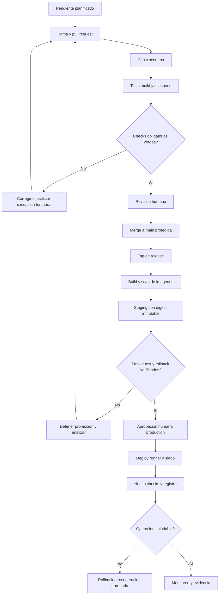

# Flujo de entrega segura

> Proceso transversal de desarrollo, seguridad y operacion. Implementa la
> estrategia del modulo 33 sin reemplazar sus checklists.

## Flujo completo

## Responsabilidades

| Etapa | Responsable | Evidencia |
|---|---|---|
| PR y correccion | Autor | Diff, tests y respuesta a comentarios |
| Checks | GitHub Actions | URL de ejecucion y logs sin datos sensibles |
| Merge | Revisor humano | Aprobacion y checks requeridos |
| Release y staging | Responsable de entrega | Tag, SHA, digests y smoke test |
| Produccion | Aprobador designado | Aprobacion de entorno y resultado de deploy |
| Recuperacion | Responsable de entrega con autorizacion | Version restaurada, pruebas y registro |

## Reglas de detencion

- Un secreto detectado bloquea hasta retirarlo, rotarlo si aplica y revisar el
  alcance; nunca se soluciona ocultando el hallazgo.
- Un fallo de staging bloquea produccion.
- Una migracion sin rollback compatible bloquea la promocion hasta tener plan
  de recuperacion aprobado.
- Un agente solo puede producir recomendaciones o un diff; no cambia este
  flujo ni lo salta.

## Referencias

- `../ESTRATEGIA/01-CI-Y-CONTROLES-DE-PR.md`
- `../ESTRATEGIA/02-CD-STAGING-Y-RECUPERACION.md`
- `../ESTRATEGIA/03-AGENTES-ABIERTOS-Y-GOBIERNO.md`
- `../ESTRATEGIA/04-GUIA-DE-IMPLEMENTACION-33.md`
