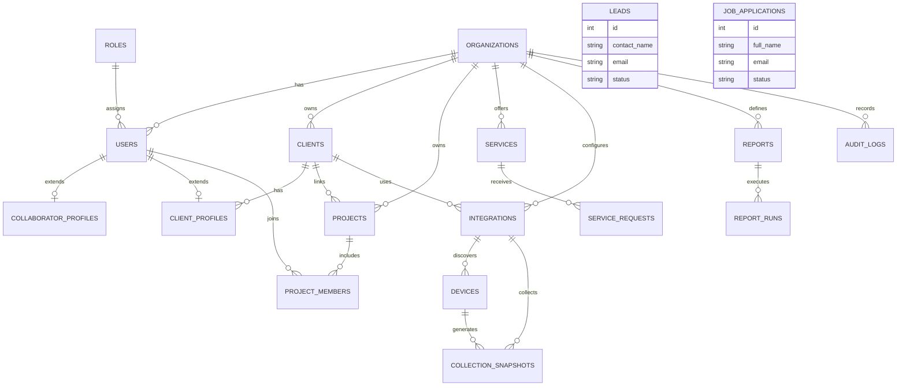

# NinjaSec - Diagrama de base de datos

## Diagrama ER simplificado



## Como ver la base de datos

### Opcion 1: Swagger + datos API

Puedes revisar entidades y datos desde:

- `http://127.0.0.1:8024/docs`

### Opcion 2: PostgreSQL por consola

Si tu contenedor es `persons_database`, ejecuta:

```powershell
docker exec -it persons_database psql -U postgres -d ninjasec
```

Comandos utiles dentro de `psql`:

```sql
\dt
\d users
\d clients
SELECT * FROM users;
SELECT * FROM clients;
SELECT * FROM integrations;
SELECT * FROM devices;
SELECT * FROM reports;
```

### Opcion 3: Exportar esquema rapido

```powershell
docker exec persons_database pg_dump -U postgres -d ninjasec --schema-only
```

### Opcion 4: Usar un cliente visual

Puedes conectarte con:

- `DBeaver`
- `pgAdmin`
- `DataGrip`

Parametros:

- host: `localhost`
- port: `5432`
- database: `ninjasec`
- user: `postgres`
- password: `123456`

## Tablas principales a revisar

- `organizations`
- `roles`
- `users`
- `clients`
- `collaborator_profiles`
- `client_profiles`
- `projects`
- `services`
- `service_requests`
- `leads`
- `job_applications`
- `integrations`
- `devices`
- `collection_snapshots`
- `reports`
- `report_runs`
- `audit_logs`
