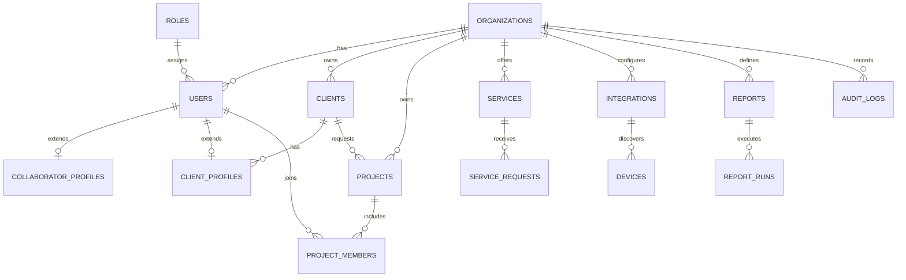

# NinjaSec - Especificacion funcional y arquitectura v2

## 1. Proposito de esta etapa

Congelar la definicion funcional y la arquitectura base de `NinjaSec` antes de seguir construyendo mas codigo. El sistema se define como una plataforma de reporting automatizado por API para infraestructura y ciberseguridad, complementada por un sitio comercial, un portal autenticado por roles y un backoffice administrativo.

## 2. Vision consolidada del producto

NinjaSec conecta dispositivos y sistemas como `pfSense`, `FortiGate` y futuras herramientas de infraestructura para extraer datos por API, normalizarlos y convertirlos en dashboards y reportes tecnicos o ejecutivos.

Capas del producto:

- `Capa publica`: presencia comercial, captacion de clientes y atraccion de talento.
- `Capa privada por rol`: acceso diferenciado para administradores, colaboradores y clientes.
- `Capa core del producto`: integraciones, dispositivos, recoleccion de datos, reportes y auditoria.

## 3. Objetivos de negocio y producto

### Objetivo principal

Construir una plataforma web que permita conectar sistemas de infraestructura por API para generar reportes automatizados, al mismo tiempo que opera como vitrina comercial y base organizacional para clientes, servicios y colaboradores.

### Objetivos especificos

- Definir un dominio consistente para clientes, colaboradores, servicios y proyectos.
- Establecer autenticacion con redireccion segun rol.
- Separar experiencia publica, administrativa y operativa.
- Mantener como nucleo innovador la generacion de reportes por API desde dispositivos.
- Preparar una arquitectura de monolito modular con proyeccion a microservicios.

## 4. Principios de arquitectura

### Decision base

Se adopta un `monolito modular`.

### Razones

- Menor complejidad inicial.
- Despliegue mas simple.
- Mayor velocidad para MVP.
- Mejor control de dominio.
- Facilita evolucion posterior a servicios separados.

### Referencias aplicadas (Context7)

- `FastAPI`: dependencias de seguridad y autorizacion con `Depends`/`Security` para RBAC.
- `Next.js App Router`: route groups `(admin)`, `(portal)` y layouts anidados para separar experiencias.
- `SQLAlchemy 2.0`: relaciones `relationship` y `Mapped` con modelos modulares.

## 5. Capas funcionales del sistema

### Capa publica

- inicio
- nosotros
- servicios
- solucion
- contacto
- agenda demo
- colabora
- login

### Capa privada

- portal de administracion
- portal de cliente
- portal de colaborador

### Capa core de negocio

- integraciones
- dispositivos
- recoleccion
- reportes
- servicios
- proyectos
- auditoria

## 6. Entidades definitivas del backend

### organizations

Representa la organizacion propietaria del sistema o la empresa cliente principal dentro del entorno multi-tenant.

Campos sugeridos:

- id
- name
- slug
- plan
- status
- created_at
- updated_at

### roles

Define los roles disponibles del sistema.

Campos sugeridos:

- id
- code
- name
- description
- is_system

Valores base:

- super_admin
- admin
- collaborator
- client
- visitor (no persistido)

### users

Representa cuentas autenticadas del sistema.

Campos sugeridos:

- id
- organization_id
- role_id
- full_name
- email
- password_hash
- status
- is_active
- last_login_at
- created_at
- updated_at
- avatar_url (nuevo)

Relaciones:

- una organizacion tiene muchos usuarios
- un rol tiene muchos usuarios

### clients

Representa la empresa o cuenta cliente.

Campos sugeridos:

- id
- organization_id
- company_name
- commercial_status
- sector
- size
- notes
- created_at
- updated_at

Relaciones:

- una organizacion tiene muchos clientes

### client_profiles

Perfil extendido del usuario cliente vinculado a un cliente.

Campos sugeridos:

- id
- client_id
- user_id
- position_title
- access_level
- phone
- preferences_json

Relaciones:

- un cliente puede tener varios contactos
- un usuario de rol client puede tener un perfil cliente

### collaborator_profiles

Perfil extendido del colaborador interno.

Campos sugeridos:

- id
- user_id
- position_title
- bio
- skills_json
- seniority
- availability_status
- portfolio_url
- created_at
- updated_at

Relaciones:

- un usuario colaborador tiene un perfil colaborador

### projects

Gestion de proyectos internos o asociados a clientes.

Campos sugeridos:

- id
- organization_id
- client_id (nullable)
- project_type_id
- area_id
- service_id
- product_id
- name
- description
- status
- start_date
- end_date
- created_at
- updated_at

### project_members

Tabla pivote entre proyectos y colaboradores.

Campos sugeridos:

- id
- project_id
- user_id
- role_in_project
- allocation_percentage
- assignment_type (manual/suggested/auto)
- is_required
- joined_at

### services

Catalogo de servicios de NinjaSec.

Campos sugeridos:

- id
- organization_id
- area_id
- project_type_id
- title
- slug
- category
- summary
- description
- is_public
- active

### service_requests

Solicitudes comerciales u operativas sobre servicios.

Campos sugeridos:

- id
- service_id
- client_id (nullable)
- requester_name
- requester_email
- request_type
- message
- status
- created_at

### leads

Leads provenientes del sitio publico.

Campos sugeridos:

- id
- company_name
- contact_name
- email
- phone
- interest_area
- message
- status
- source
- created_at

### job_applications

Postulaciones de talento.

Campos sugeridos:

- id
- full_name
- email
- phone
- desired_role
- skills_summary
- cv_url
- portfolio_url
- status
- created_at

### integrations

Configuraciones de conectores API para clientes o ambientes.

Campos sugeridos:

- id
- organization_id
- client_id (nullable)
- connector_type
- name
- base_url
- auth_type
- status
- last_sync_at
- created_at

### devices

Activos conectados a una integracion.

Campos sugeridos:

- id
- integration_id
- client_id (nullable)
- hostname
- vendor
- model
- ip_address
- status
- last_seen_at

### reports

Definicion logica de reportes.

Campos sugeridos:

- id
- organization_id
- client_id (nullable)
- integration_id (nullable)
- device_id (nullable)
- title
- report_type
- template_name
- created_by
- created_at

### report_runs

Ejecuciones del reporte.

Campos sugeridos:

- id
- report_id
- status
- started_at
- finished_at
- output_file
- summary_json

### audit_logs

Registro de acciones criticas del sistema.

Campos sugeridos:

- id
- organization_id
- user_id (nullable)
- action
- entity_type
- entity_id
- metadata_json
- created_at

## 7. Relaciones clave del dominio



## 8. Permisos por rol (estandar v2)

| Rol | Acceso principal | Permisos clave | Nivel | Notas |
| --- | --- | --- | --- | --- |
| super_admin | Backoffice total | gestionar usuarios, clientes, colaboradores, proyectos, servicios, integraciones, reportes, auditoria, configuracion | L3 | aprueba skills/certs/docs, puede ver todo |
| admin | Backoffice operativo | gestionar clientes, colaboradores, proyectos, servicios, integraciones, reportes, leads, postulaciones | L2 | no gestiona configuracion global |
| collaborator | Portal colaborador | ver perfil, actualizar habilidades, ver proyectos asignados, ver recursos, consultar tareas | L1 | acceso limitado por asignacion |
| client | Portal cliente | ver perfil empresarial, consultar reportes, documentos, estado del servicio, solicitudes y soporte | L1 | acceso por cliente |
| visitor | Sitio publico | navegar paginas publicas, contactar, agendar demo, postular | L0 | sin sesion |

### Roles extendidos (propuestos)

- `collaborator_admin`: colaborador con permisos de gestion interna limitada (equipos, asignaciones, aprobaciones internas).
- `client_admin`: cliente con permisos de administrar usuarios de su empresa y solicitudes.

## 9. Flujos de autenticacion y redireccion

### Flujo de login

1. Usuario entra a `/login` o `/`.
2. Envia credenciales.
3. Backend valida cuenta y rol.
4. Backend responde token + `redirect_to`.
5. Frontend guarda sesion.
6. Frontend redirige segun rol.

### Reglas de redireccion

- super_admin -> `/dashboard`
- admin -> `/dashboard`
- collaborator -> `/portal`
- client -> `/portal`

### Guardias de ruta

- `dashboard` solo para admin y super_admin
- `portal` solo para collaborator y client
- paginas publicas disponibles sin sesion

## 10. Mapa de paginas publicas

| Ruta | Objetivo | Tipo de usuario |
| --- | --- | --- |
| `/` | landing principal y CTA | visitor |
| `/nosotros` | mision, vision, equipo, propuesta | visitor |
| `/servicios` | catalogo de servicios | visitor |
| `/solucion` | explicacion del producto principal | visitor |
| `/contacto` | formulario general | visitor |
| `/agenda-demo` | captacion de leads | visitor |
| `/colabora` | postulacion de talento | visitor |
| `/login` | autenticacion | all |

## 11. Mapa de paginas privadas

### Admin

| Ruta | Objetivo |
| --- | --- |
| `/dashboard` | resumen ejecutivo y operativo |
| `/dashboard/users` | gestion de usuarios |
| `/dashboard/clients` | gestion de clientes |
| `/dashboard/collaborators` | gestion de colaboradores |
| `/dashboard/projects` | gestion de proyectos |
| `/dashboard/services` | gestion del catalogo |
| `/dashboard/integrations` | conectores y credenciales |
| `/dashboard/reports` | reportes e historial |
| `/dashboard/audit` | trazabilidad y control |
| `/dashboard/settings` | configuracion global |

### Portal cliente / colaborador

| Ruta | Objetivo |
| --- | --- |
| `/portal` | home del portal |
| `/portal/profile` | perfil del usuario |
| `/portal/company` | vista de empresa o cliente |
| `/portal/projects` | proyectos asignados |
| `/portal/reports` | reportes visibles por rol |
| `/portal/support` | soporte, solicitudes y seguimiento |

## 12. Layouts y navegacion del frontend

### Layout publico

- header corporativo
- footer
- CTA de contacto y login

### Layout admin

- sidebar de modulos administrativos
- topbar con sesion y acciones rapidas
- panel central de gestion

### Layout portal

- menu simplificado
- foco en perfil, proyectos, reportes y soporte

### Referencia aplicada

`Next.js App Router` con route groups `(public)`, `(admin)`, `(portal)` para aislar layouts.

## 13. Tabla modulo -> entidad -> endpoint -> vista

| Modulo | Entidad principal | Endpoints base | Vistas asociadas |
| --- | --- | --- | --- |
| Auth | users, roles | `POST /auth/login`, `GET /auth/me` | `/login`, guards de ruta |
| Organizations | organizations | `GET /organizations`, `POST /organizations` | admin settings |
| Users | users, roles | `GET/POST/PUT/DELETE /users` | `/dashboard/users` |
| Clients | clients, client_profiles | `GET/POST/PUT/DELETE /clients` | `/dashboard/clients`, `/portal/company` |
| Collaborators | collaborator_profiles | `GET/POST/PUT/DELETE /collaborators` | `/dashboard/collaborators`, `/portal/profile` |
| Projects | projects, project_members | `GET/POST/PUT/DELETE /projects` | `/dashboard/projects`, `/portal/projects` |
| Services | services | `GET/POST/PUT/DELETE /services` | `/servicios`, `/dashboard/services` |
| Service Requests | service_requests | `GET/POST /service-requests` | `/contacto`, admin requests |
| Leads | leads | `GET/POST /leads` | `/agenda-demo` |
| Recruitment | job_applications | `GET/POST /job-applications` | `/colabora`, admin talent |
| Integrations | integrations | `GET/POST/PUT/DELETE /integrations` | `/dashboard/integrations` |
| Devices | devices | `GET/POST/PUT/DELETE /devices` | dispositivos dentro de integraciones |
| Reports | reports, report_runs | `GET/POST /reports`, `GET /report-runs` | `/dashboard/reports`, `/portal/reports` |
| Audit | audit_logs | `GET /audit-logs` | `/dashboard/audit` |

## 14. Estructura recomendada del backend

```text
backend/
  app/
    api/
      router.py
    core/
      config.py
      security.py
      permissions.py
    db/
      base.py
      session.py
      deps.py
      models/
    modules/
      auth/
      organizations/
      users/
      clients/
      collaborators/
      projects/
      services/
      leads/
      recruitment/
      integrations/
      devices/
      reports/
      audit/
    schemas/
    services/
```

## 15. Estructura recomendada del frontend

```text
frontend/src/
  app/
    (public)/
      page.tsx
      nosotros/
      servicios/
      solucion/
      contacto/
      agenda-demo/
      colabora/
      login/
    (admin)/
      dashboard/
        page.tsx
        users/
        clients/
        collaborators/
        projects/
        services/
        integrations/
        reports/
        audit/
    (portal)/
      portal/
        page.tsx
        profile/
        company/
        projects/
        reports/
        support/
  components/
  lib/
  features/
```

## 16. Camino feliz por tipo de usuario

### Visitante

- entra a la landing
- entiende la propuesta de valor
- navega a servicios o solucion
- agenda demo o postula como colaborador

### Cliente potencial

- llena `agenda-demo`
- queda registrado como lead
- admin evalua y convierte en cliente

### Cliente autenticado

- inicia sesion
- es redirigido a `/portal`
- consulta reportes, estado de servicio, documentos y soporte

### Colaborador autenticado

- inicia sesion
- es redirigido a `/portal`
- consulta su perfil, proyectos, habilidades y tareas relacionadas

### Admin / Super Admin

- inicia sesion
- es redirigido a `/dashboard`
- administra usuarios, clientes, colaboradores, servicios, proyectos e integraciones

## 17. Roadmap tecnico por fases

### Fase A - Fundacion

- cerrar especificacion funcional
- congelar entidades del dominio
- definir permisos por rol
- preparar layouts y rutas maestras

### Fase B - Autenticacion y acceso

- login unico
- JWT o token firmado
- redireccion por rol
- guards de ruta
- logout y sesion

### Fase C - Sitio publico y captacion

- construir inicio, nosotros, servicios y solucion
- implementar contacto, agenda demo y colabora
- persistir leads y postulaciones

### Fase D - Backoffice administrativo

- usuarios
- clientes
- colaboradores
- proyectos
- servicios
- auditoria

### Fase E - Portal por rol

- portal cliente
- portal colaborador
- perfil y vistas contextualizadas

### Fase F - Core de reporting por API

- integraciones
- dispositivos
- recoleccion
- reportes
- historial de ejecuciones

### Fase G - Endurecimiento

- seguridad
- validaciones
- auditoria completa
- pruebas
- despliegue

## 18. Especificaciones funcionales extendidas por modulo (mejoras)

### Usuarios y roles

- Perfil con avatar (subida o URL).
- Roles extendidos: `collaborator_admin`, `client_admin`.
- Matriz de permisos por nivel (L3/L2/L1/L0).
- Auditoria de cambios de rol y estado.

### Clientes

- Multi-contacto por cliente.
- Historial comercial y estado.
- Requests y soporte asociado.

### Colaboradores

- Skills y certificaciones verificadas.
- Disponibilidad y carga (allocation).
- Historial de proyectos.

### Proyectos

- Proyectos por tipo (implementacion, consultoria, soporte).
- Area y service/product auto-asignado.
- Reglas de negocio: proyecto activo requiere colaboradores.
- Requerimientos de skills y recomendaciones.

### Servicios

- Catalogo publico y privado.
- Tags por area y tipo.

### Integraciones y dispositivos

- Estado de conexion.
- Salud de dispositivos y ultima sincronizacion.

### Reportes

- Versionado de plantillas.
- Historial y comparativas.

### Auditoria

- Log unificado por modulo.
- Filtros por usuario, entidad y accion.

## 19. Mejoras backend (propuestas)

- RBAC formal con `Security` y scopes por modulo.
- Endpoint de permisos por rol para UI.
- Modelos de avatar y storage.
- Validaciones de reglas de negocio (estado proyecto, asignaciones).
- Auditoria automatica en acciones criticas.

## 20. Mejoras frontend (propuestas)

- Cards unificadas para usuarios, clientes, colaboradores y proyectos.
- Vista detalle de proyecto con tabs: info, miembros, docs, skills.
- Edicion inline con permisos segun rol.
- Avatar consistente con fallback de iniciales.
- Responsive mejorado para grids y tarjetas.

## 21. Interaccion de usuarios por rol (detalle)

### super_admin

- Ve todo el backoffice y configuracion global.
- Aprueba skills, certificaciones y documentos.

### admin

- Gestiona modulos operativos.
- No modifica configuracion global ni billing.

### collaborator_admin (propuesto)

- Gestiona asignaciones de colaboradores.
- Puede aprobar skills internas.

### collaborator

- Ve sus proyectos, tareas y docs asignados.
- Actualiza perfil y skills.

### client_admin (propuesto)

- Gestiona usuarios de su empresa.
- Gestiona solicitudes y accesos internos.

### client

- Ve reportes y documentos del cliente.

## 22. Conclusiones de la etapa

NinjaSec deja de ser solo un dashboard de pruebas y pasa a definirse formalmente como una plataforma de reporting por API con presencia comercial, portal por roles y backoffice administrativo. Esta especificacion v2 fija la base para continuar la construccion sin perder el enfoque innovador del producto ni la linea comercial de la empresa.
