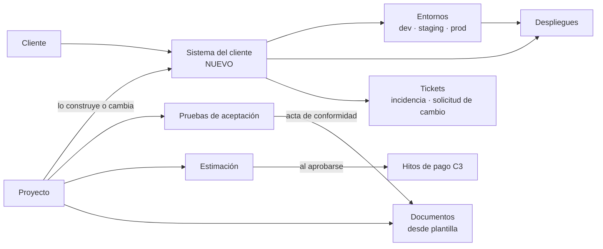

# 35 - Ninja Dev: operación y gestión de clientes

> Estado: planificado el 2026-11-25, a pedido del usuario.
> Depende de: `34` (modos Sec/Dev, `areas.business_line`), C1 (decisión del
> cliente sobre documentos, PR #49) y C3 (hitos de pago, PR #50).
> Base: la propuesta de `DOCUMENTOS/NINJA-DEV/09-MODULOS-PROPUESTOS.md`.

## Objetivo

Ninja Dev entrega **software a medida** y luego lo **mantiene**. Hoy la
plataforma sigue bien un proyecto mientras dura (fases, tareas, avances,
entregables, pagos), pero no sabe nada de lo que queda **después**: qué
sistema se entregó, dónde corre, qué versión tiene, qué garantía o
mantenimiento cubre, y qué pide el cliente cuando quiere un cambio.

Este documento planifica esa parte, en dos frentes:

| Frente | Pregunta que responde |
| --- | --- |
| **Operación** | ¿Qué desplegamos, dónde, cuándo y cómo se vuelve atrás? ¿Lo probó el cliente? ¿Cuánto cuesta lo que vamos a hacer? |
| **Gestión del cliente Dev** | ¿Qué sistemas tiene con nosotros, en qué estado, y cómo pide un cambio o reporta un fallo? |

## La regla que acota todo

**No llenar la plataforma de módulos.** Cada pieza de abajo amplía algo que
ya existe, salvo **una tabla nueva de verdad**: el *sistema del cliente*, que
es lo que falta para que todo lo demás tenga dónde colgarse.

Fuera de alcance, a propósito:

- Sprints, tablero de tareas, estimación por puntos: se hace en **ClickUp**.
- Integración con GitHub o con proveedores de nube por API (webhooks, leer
  despliegues automáticamente): primero se valida el registro manual.
- Facturación electrónica y pasarela de pago: C3 ya cubre el estado.
- Guardar **secretos** del cliente (claves, tokens, contraseñas de hosting).
  La plataforma solo dice **dónde** están (p. ej. "en el gestor de la
  empresa, entrada X"), nunca el valor.

## Modelo: dónde cuelga cada cosa

Un **proyecto** termina; el **sistema** sigue. Por eso entornos, despliegues
y soporte cuelgan del sistema, y el proyecto solo dice "este proyecto
construye o cambia este sistema".

## Los módulos

### 35-P-01 · Sistemas del cliente y sus entornos — **base de todo**

Qué es: la ficha de cada sistema que Ninja Dev entregó o mantiene para un
cliente.

| Campo | Notas |
| --- | --- |
| `name`, `client_id`, `organization_id` | Obligatorios |
| `description` | Qué hace, en una línea que entienda el cliente |
| `stack` | Texto libre corto (p. ej. "Next.js + FastAPI + PostgreSQL") |
| `repository_url` | Opcional; no se muestra al cliente salvo que sea suyo |
| `status` | `en_construccion` · `en_produccion` · `en_mantenimiento` · `retirado` |
| `warranty_until` | Fecha fin de garantía; la plataforma avisa 30 días antes |
| `support_plan` | `ninguno` · `basico` · `profesional` · `a_medida` (sin precios: viven en `ninjasec-empresa`) |
| `origin_project_id` | El proyecto que lo construyó |

**Entornos** (tabla hija `client_system_environments`): `kind`
(`dev`/`staging`/`prod`), `url`, `hosting` (texto: "Oracle Cloud", "Vercel"…),
`domain_expires_at`, `certificate_expires_at`, `secrets_location` (texto que
dice **dónde** están las claves, nunca cuáles son), `visible_to_client`.

Quién ve qué:

- Admin: todo, de su organización; crea y edita.
- Colaborador: los sistemas de los proyectos donde es miembro, en lectura.
- Cliente: **solo los suyos**, sin `repository_url` ni `secrets_location`, y
  solo los entornos marcados `visible_to_client`.

Pantallas: pestaña **Sistemas** en la ficha del cliente (admin) y sección
**Mis sistemas** en el portal.

### 35-P-02 · Registro de despliegues

Qué es: cada vez que algo sale a un entorno, queda escrito. Sustituye el
"¿qué versión tiene producción?" por un dato.

| Campo | Notas |
| --- | --- |
| `system_id`, `environment_id` | El entorno debe pertenecer al sistema |
| `version` | Etiqueta o SHA corto |
| `summary` | Qué cambió, en lenguaje de cliente |
| `deployed_by`, `deployed_at` | Quién y cuándo |
| `checklist` | Respaldo hecho · prueba de humo pasó · plan de vuelta atrás escrito (tres booleanos) |
| `rollback_plan` | Texto corto: cómo se revierte |
| `result` | `ok` · `fallido` · `revertido` |
| `project_id` | Opcional: el proyecto al que pertenece este cambio |

Reglas:

- No se registra un despliegue a `prod` con `result = ok` si el checklist no
  tiene **respaldo** y **prueba de humo** marcados (422 con el motivo).
- Un despliegue `ok` a `prod` publica un avance en la bitácora del proyecto
  (`tracking`) visible para el cliente: "Versión X publicada".
- El cliente ve los despliegues a `prod` de sus sistemas (versión, fecha,
  resumen); nunca el checklist interno.

### 35-P-03 · Solicitudes de cambio (dentro de Tickets)

Qué es: el cliente pide algo nuevo sobre un sistema que ya tiene. **No es un
módulo nuevo**: es un tipo de ticket.

- `support_tickets` gana `kind` (`incidencia` · `cambio`) y `system_id`
  opcional.
- Un ticket `cambio` añade: `estimate_hours`, `estimate_note`,
  `client_decision` (`approved` · `rejected`) con fecha y quién, siguiendo el
  patrón de C1.
- Flujo: el cliente lo abre desde **Mis sistemas** → el equipo estima → el
  cliente aprueba o rechaza en el portal → si aprueba, el admin lo convierte en
  tareas de un proyecto (existente o nuevo) con un clic.
- Si el sistema está en garantía y el ticket es `incidencia`, la ficha lo
  marca: "en garantía hasta …".

### 35-P-04 · Estimador de costos

Qué es: partidas por rol × horas, más infraestructura, licencias y soporte;
el resultado alimenta la cotización y, al aprobarse, los **hitos de pago**.

| Pieza | Notas |
| --- | --- |
| `estimates` | `project_id`, `version`, `status` (`borrador` · `enviada` · `aprobada` · `rechazada`), moneda |
| `estimate_items` | `kind` (`hora` · `infra` · `licencia` · `soporte`), `role`, `hours`, `unit_cost`, `risk_percent`, `recurring` |
| Tarifas | Tabla `rate_cards` por rol, **solo admin**. Nunca en el repo público ni en el seed: se cargan en producción |

Reglas:

- Solo admin crea, ve tarifas y aprueba. El colaborador puede proponer horas
  por partida, sin ver tarifas ni totales.
- El cliente **no** ve el estimador: ve la cotización final como documento
  (35-P-06) y los hitos de pago (C3).
- Al pasar a `aprobada`, ofrece generar los hitos de pago (p. ej. 50/30/20)
  como **propuesta editable**; no los crea sin confirmación.
- Una versión aprobada no se edita: se crea la siguiente.

### 35-P-05 · Pruebas de aceptación (UAT)

Qué es: la lista de lo que el cliente tiene que comprobar antes de dar el
sistema por recibido.

- `acceptance_cases`: `project_id`, `title`, `steps`, `expected`, `status`
  (`pendiente` · `aprobado` · `observado`), `client_note`, fecha y quién.
- El equipo escribe los casos; el cliente los marca en el portal. Observar
  exige nota (≥5 caracteres), como C1.
- Cuando todos están `aprobado`, la plataforma propone generar el **acta de
  conformidad** (35-P-06), que el cliente aprueba con C1.

### 35-P-06 · Documentos desde plantilla

Qué es: propuesta, alcance (SOW), acta de inicio, acta de conformidad y
cotización generados con los datos del proyecto, **dentro del módulo de
documentos que ya existe**.

- Plantillas Markdown con campos (`{{cliente}}`, `{{proyecto}}`,
  `{{hitos}}`, `{{casos_uat}}`…). Las versiones con texto comercial viven en
  `ninjasec-empresa/PLANTILLAS`; en el repo público solo plantillas genéricas.
- Generar crea un `project_doc` en **borrador** e interno. El equipo lo
  revisa, lo publica y el cliente lo aprueba con C1.
- Nada se envía solo: publicar es una acción del admin.

### 35-P-07 · Mantenimiento y SLA — **bloqueado por decisión de negocio**

Qué es: horas incluidas por mes según el plan de soporte del sistema,
consumo a partir de los tickets, tiempos de respuesta y reporte mensual.

**No se programa** hasta que Mark fije las reglas comerciales: horas por
plan, qué cuenta como incidencia o como cambio, tiempos de respuesta y qué
pasa con el exceso. Hasta entonces, `support_plan` (35-P-01) solo informa.

### 35-P-08 · Panel Ninja Dev

Qué es: lo que ve el admin en modo **Ninja Dev** (ver `34`), solo con datos
reales de lo anterior:

- Sistemas en producción, y los que vencen garantía, dominio o certificado
  en los próximos 30 días.
- Últimos despliegues y los fallidos o revertidos.
- Solicitudes de cambio esperando estimación o esperando al cliente.
- Proyectos con casos de aceptación observados.

## Orden de trabajo y reparto

Cada fila es un PR. Las T4 (tablas con `organization_id`, migraciones,
permisos) las hace el agente principal; las pantallas (T3) las puede tomar un
colaborador **una vez fusionado el backend**, contra el contrato de la API.

| # | Pieza | Backend (T4) | Frontend (T3) | Depende de |
| --- | --- | --- | --- | --- |
| 1 | 35-P-01 Sistemas y entornos | Claude | Colaborador | `34` (business_line) |
| 2 | 35-P-02 Despliegues | Claude | Colaborador | 1 |
| 3 | 35-P-03 Solicitudes de cambio | Claude | Colaborador | 1, C1 |
| 4 | 35-P-05 Pruebas de aceptación | Claude | Colaborador | C1 |
| 5 | 35-P-04 Estimador | Claude | Claude (tarifas privadas) | C3 |
| 6 | 35-P-06 Documentos desde plantilla | Claude | Colaborador | 4, 5 |
| 7 | 35-P-08 Panel Ninja Dev | — | Colaborador | 1–3 |
| — | 35-P-07 Mantenimiento y SLA | Bloqueado | Bloqueado | Decisión de Mark |

## Criterios de aceptación (todos los módulos)

- Toda tabla nueva lleva `organization_id`; lo de otra organización o de otro
  cliente devuelve **404**.
- El cliente nunca ve: tarifas, totales internos del estimador, checklist de
  despliegue, `repository_url` ajeno, `secrets_location`, notas internas.
- Toda creación, cambio de estado y decisión del cliente queda en la
  auditoría con `AuditService`.
- Cada migración se prueba en PostgreSQL desechable: sube, baja y vuelve a
  subir, con `alembic check` sin diferencias. Respaldo de producción antes de
  publicarla.
- Cada PR trae pruebas que fijan los permisos de los tres roles y al menos
  una mutación comprobada (quitar el control de acceso hace fallar una prueba).
- Ningún secreto se guarda: un campo con forma de clave (`sk-…`, `ghp_…`,
  `-----BEGIN`) en `secrets_location` se rechaza con 422.
